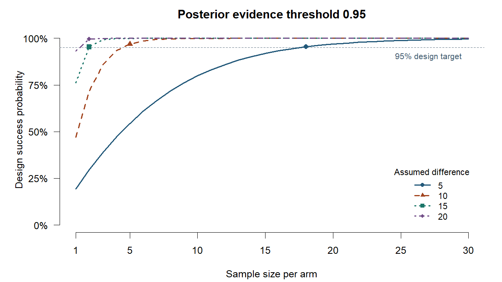

# Bayesian Planning for a Hypothetical LDL Trial

How do the assumed treatment difference and the required strength of evidence change sample size? I compared a hypothetical new LDL-lowering treatment with an active comparator under a normal model. The arms are equal in size, the within-arm SD is known and fixed at 4.5, and the treatment difference has a diffuse N(0, 100²) analysis prior. A positive difference favors the new treatment.

[Read the case study](https://666mhy666.github.io/projects/bayesian-trial-design/) · [Open the R analysis](analysis.R) · Independent UCLA graduate coursework

## Two probabilities

- **Posterior evidence threshold.** After a trial, declare success when its posterior probability of a positive treatment difference exceeds 95% or 97.5%.
- **Design success target.** Before a trial, choose the smallest sample size that would clear the posterior threshold in at least 95% of repeated trials at the assumed true difference. The separate `design_assurance()` helper averages over a design prior.

## Results

| Assumed difference | n per arm at 95% posterior | n per arm at 97.5% posterior |
| ---: | ---: | ---: |
| 5 | 18 | 22 |
| 10 | 5 | 6 |
| 15 | 2 | 3 |
| 20 | 2 | 2 |

[Sample-size results](results/sample-sizes.csv) include a one-sided frequentist calculation at α = 0.05 or 0.025 and 95% power. With matched cutoffs and a diffuse prior, the two methods returned the same integer counts in these scenarios. I checked the exact success probabilities against 100,000 seeded simulated trial estimates per scenario at the 95% posterior threshold. [Simulation check](results/simulation-check.csv)

The small counts reflect large assumed effects relative to a known SD, with no allowance for dropout or a practical enrollment minimum. They illustrate the hypothetical design assumptions.

## Reproduce

From the repository root, run `Rscript analysis.R results` with base R. The script defines every input, writes both numerical tables, verifies the exact probabilities by simulation and generates the figure. See the [report](REPORT.md), [inputs](DATA_ACCESS.md) and [revision notes](REVISION_NOTES.md) for details.
