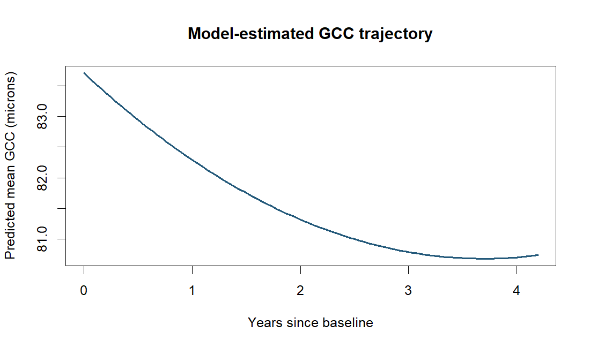

# Longitudinal Retinal Thickness in Glaucoma

I modeled retinal ganglion cell complex (GCC) thickness in 107 patients across 786 visits. Patients returned at different intervals, so I compared models that account for the actual time between measurements.

[Read the case study](https://666mhy666.github.io/projects/glaucoma-progression/) · [Open the R analysis](analysis.R) · Independent UCLA graduate coursework

## What I found

A quadratic curve fit the population mean better by BIC than the flat, linear and log-time alternatives. The fitted decline became less steep, with a minimum around 3.7 years and a slight upturn near the end of follow-up. I interpret that upturn cautiously as a feature of the fitted quadratic at the boundary. For the same quadratic mean, random intercepts and slopes plus continuous-time AR(1) residual correlation gave the lowest BIC (4,078.6). This allows different starting thicknesses and slopes by patient, and residual correlation that fades as visits get farther apart.



_The figure shows population-level model predictions._

## Age and baseline thickness

Adding baseline age and an age-by-time term did not improve BIC in the revised comparison. In a separate model of follow-up visits, the higher baseline-GCC group had a steeper fitted decline. Grouping by the first measurement can produce regression to the mean even when that visit is excluded from the model. The subgroup result is exploratory.

## Start here

[analysis.R](analysis.R) runs the mean and covariance comparisons, the age and baseline-group analyses, and residual diagnostics. See the [report](REPORT.md) for the model choices and result tables, the [diagnostic plot](results/diagnostics.png), and the [revision notes](REVISION_NOTES.md).

Use R 4.5.2 with `nlme`. Obtain the authorized extract described in [DATA_ACCESS.md](DATA_ACCESS.md) and run from the repository root:

```sh
Rscript analysis.R data/ADAP_Macula_GCC_dataset.csv data/reproduced-results
```
