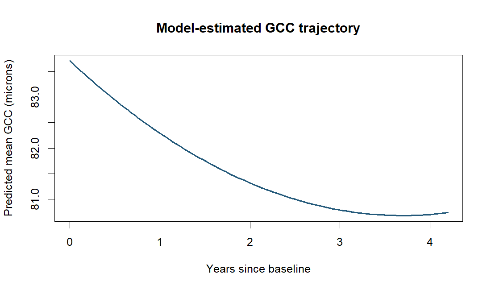

# Methods and interpretation

## Data and original exploration

The course extract contains 107 subjects and 786 repeated ganglion cell complex (GCC) thickness measurements, in micrometers. Time is recorded as years since baseline, with observed follow-up through about 4.2 years. Visit spacing varies. The original coursework inspected individual subject profiles, the distribution of GCC, and baseline GCC against baseline age. Those plots showed differences in starting thickness and rates of change across subjects. Individual profiles and the source visit table remain private.

## Mean and covariance comparisons

The coursework compared intercept-only, linear, quadratic and log-time mean models. It also explored random intercepts, random slopes, random intercepts and slopes, random quadratic terms, compound symmetry, and a continuous-time AR(1) specification. Its continuous-time candidate used a linear mean, while several other candidates used a quadratic mean.

The public [R analysis](analysis.R) uses maximum likelihood to compare all four mean structures on the same cohort with random intercepts. The quadratic had the lowest BIC in that comparison (4,238.2). It then holds the quadratic mean fixed and compares the covariance candidates by restricted maximum likelihood. The three candidates use random intercepts (BIC 4,242.7), random intercepts and linear slopes (4,101.5), and random intercepts and slopes plus continuous-time AR(1) (4,078.6). Visit times are entered in years. The residual correlation in the selected model decreases with increasing time separation after accounting for patient-specific trajectories.

| Fixed term | Estimate | 95% CI |
| --- | ---: | ---: |
| Intercept | 83.704 | 80.506 to 86.902 |
| Time | −1.634 | −2.117 to −1.152 |
| Time squared | 0.221 | 0.105 to 0.336 |

The fitted decline became less steep, reaching a minimum at about 3.7 years before turning slightly upward near the end of the observed range (4.2 years). The small upturn reflects the quadratic fit at the boundary and warrants caution about any interpretation as retinal recovery. The model uses `predict(..., level = 0)` to evaluate the population mean on a grid over the observed time range.

_The figure shows population-level model predictions._

## Age and baseline severity

The coursework explored age as a predictor of baseline level and of changes over time, including interaction terms for linear and quadratic time. The revised age comparison fits both models by maximum likelihood, with the same cohort and covariance structure. Adding baseline age and its interaction with linear time increased BIC from 4,075.2 to 4,086.3. This comparison offers limited support for the additional terms.

The coursework also compared linear slopes in groups defined by starting GCC. The revised model takes one baseline measurement per subject, splits at the median of 82 µm, and fits the time-by-group interaction using visits after baseline. The estimated higher-minus-lower slope difference was −0.559 µm/year. Patients are grouped by a noisy first measurement, so regression to the mean can still affect their subsequent trajectories even when the first visit is excluded. This result does not establish a biological difference in progression.

## Diagnostics and limitations

The public diagnostics show normalized residuals against fitted values and a normal Q–Q plot. Model comparisons are exploratory and the coefficient intervals do not account for model selection. Interpretation is limited to the observed cohort and follow-up range.

## Supporting files

- [Mean models](results/mean-models-ml.csv), [covariance models](results/covariance-models.csv) and [selected-model coefficients](results/coefficients.csv)
- [Trajectory data](results/mean-trajectory.csv) and [residual diagnostics](results/diagnostics.png)
- [Age models](results/age-models-ml.csv) and [baseline-group interaction](results/exploratory-baseline-interaction.csv)
- [Run summary](results/run.txt), [R session information](results/session-info.txt), [data access](DATA_ACCESS.md) and [revision notes](REVISION_NOTES.md)
