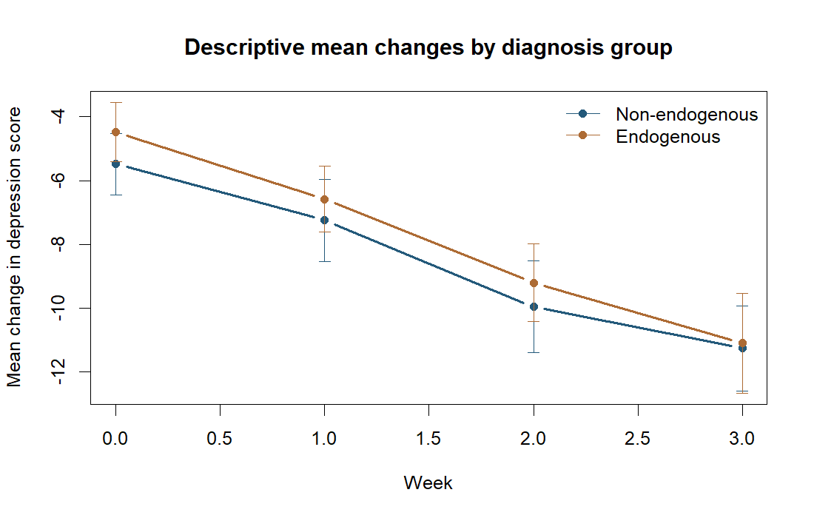

# Depression Trajectories and Drug Concentration

I used R to study how changes in depression scores over four weeks related to diagnosis and measured drug concentrations. The historical `riesby` teaching dataset includes **250 observations from 66 patients** across weeks 0–3, with measured plasma imipramine and desipramine. Repeated observations from a patient can be related, so the analysis accounts for that dependence.

[Read the case study](https://666mhy666.github.io/projects/longitudinal-depression/) · Independent UCLA graduate coursework

## What I compared

I examined patient profiles and weekly means by diagnosis. In the revised analysis, I used maximum likelihood to compare fixed effects for week, diagnosis and the two drugs. Then I held the fixed effects constant and used restricted maximum likelihood to compare patient-level random effects and residual covariance structures. The model allowing each patient a different intercept and slope had the lowest BIC in that second comparison. [Model comparisons and specifications](REPORT.md#analysis)

## Main finding

The selected model estimated a **week × desipramine coefficient of −0.887** (95% CI −1.551 to −0.224). At two concentrations one unit apart, and holding diagnosis constant, the estimated weekly slope of score change was 0.887 points lower at the higher concentration. The unit is on the dataset’s recorded scale. This is an association with measured concentration. [Coefficient table](results/coefficients.csv)



_Observed weekly means by diagnosis group. The bars show ±1 standard error. The plot does not use drug concentrations. The fitted interaction is reported above._

## Important limitations

The model combines differences between patients with changes within a patient. The sample is small, and the interval does not account for model selection. [Residual diagnostics](results/diagnostics.png)

## Start here

Start with [analysis.R](analysis.R) for the full analysis and [REPORT.md](REPORT.md) for candidate models, selection and interpretation. The saved run used R 4.5.2 with `nlme`. Follow [DATA_ACCESS.md](DATA_ACCESS.md) to prepare the input. From the repository root, run:

```sh
Rscript analysis.R data/riesby.csv data/reproduced-results
```


This writes an independent copy of the outputs. See [REVISION_NOTES.md](REVISION_NOTES.md) for the coursework and portfolio history.

