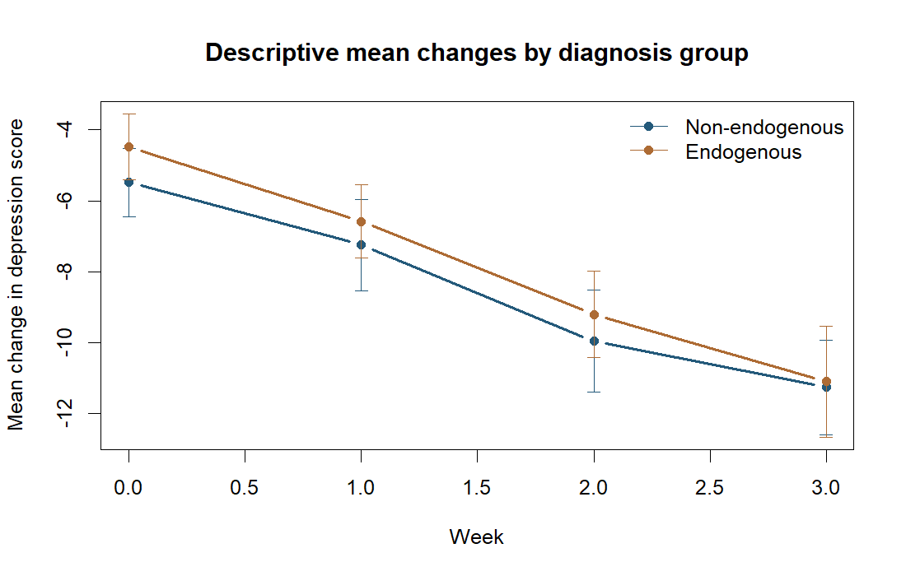

# Methods and interpretation

## Question

How are changes in depression scores associated with diagnosis and measured drug concentration after accounting for repeated observations?

## Data

The historical `riesby` teaching dataset provides 250 complete observations from 66 patients at weeks 0–3. The outcome is the recorded change in depression score. The diagnosis indicator distinguishes endogenous and non-endogenous depression. Imipramine and desipramine are observed plasma concentrations. [Data access and variable source](DATA_ACCESS.md)

## Analysis

The coursework began with individual patient trajectories and weekly group summaries. It compared diagnosis and time trends, explored imipramine and desipramine, and assessed random effects, residual correlation and model diagnostics.

The revised [analysis.R](analysis.R) uses the same complete-case sample for two comparisons:

1. **Compare fixed effects with maximum likelihood (ML).** With a subject random intercept, the candidate formulas allow a common weekly slope by diagnosis, a diagnosis-specific slope, interactions of week with imipramine or desipramine, or the week-by-desipramine interaction with an additional imipramine main effect. See the [fixed effects table](results/mean-models-ml.csv).
2. **Compare within-patient covariance with restricted maximum likelihood (REML).** Each candidate uses the fixed formula `week * desipramine + endogenous`. Compare random intercept only (RI), random intercept and slope (RIAS), compound symmetry (CS), and residual AR(1), heterogeneous AR(1) and unstructured covariance. AR(1) ties correlation to the number of weeks apart. Heterogeneous AR(1) also permits week-specific residual variances. The unstructured fit uses freely estimated correlations and week-specific variances. The AR(1) fits include a random intercept. Compound symmetry and the unstructured fit use generalized least squares. See the [covariance table](results/covariance-models.csv).

Random effects let patients differ in their modeled levels or slopes. Residual covariance describes how deviations from those trajectories are related across visits. The final RIAS model had the lowest BIC among the covariance candidates. The saved [diagnostic plots](results/diagnostics.png) show normalized residuals against fitted values and week, a Q-Q plot and a histogram.

## Findings

The selected random intercept and slope model estimated the week × desipramine coefficient at −0.887 (95% CI −1.551 to −0.224, nominal p = 0.009). For two fixed concentration values one unit apart on the dataset's scale, the higher concentration corresponds to a weekly slope of score change that is 0.887 points lower, holding diagnosis constant.

_Observed weekly means by diagnosis group, with one standard error above and below each mean. Drug concentrations do not enter this descriptive summary._

## Assumptions and interpretation

Drug concentrations vary over time. The interaction describes the fitted association conditional on diagnosis. This parameter can reflect both between-patient differences and within-patient changes. The small sample and model selection limit the interpretation of the interval and nominal p-value.

## Result files

- [coefficients.csv](results/coefficients.csv)
- [covariance-models.csv](results/covariance-models.csv)
- [depression-trajectories.png](results/depression-trajectories.png)
- [diagnostics.png](results/diagnostics.png)
- [mean-models-ml.csv](results/mean-models-ml.csv)
- [run.txt](results/run.txt)
- [session-info.txt](results/session-info.txt)
- [weekly-means.csv](results/weekly-means.csv)
Source context: [https://multilevelmod.tidymodels.org/reference/riesby.html](https://multilevelmod.tidymodels.org/reference/riesby.html)

