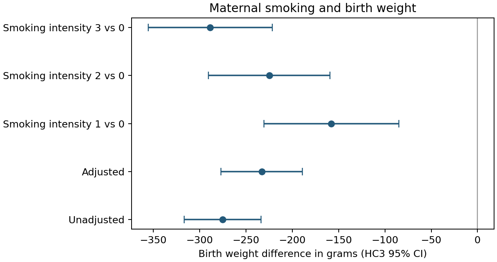

# Maternal Smoking and Birth Weight

How much does the birth weight difference associated with maternal smoking change after adjustment? I compared births by reported smoking during pregnancy and fit both models on the same 4,642 complete records (864 with reported smoking and 3,778 without).

[Read the case study](https://666mhy666.github.io/projects/maternal-smoking-birthweight/) · [Open the Python analysis](analysis.py) · Independent UCLA graduate coursework

## Why adjust?

The recorded smoking intensity codes agreed with the binary indicator. The original histograms showed a shift toward lower birth weights in the smoking group. The groups also differed in maternal age, education, marital status and alcohol use. I used a [DAG](results/coursework-dag.svg) to choose maternal age, race, education, marital status and alcohol use for adjustment. The graph places prenatal care on a possible pathway from smoking to birth weight, so I left it out of the primary model.

The [overlap counts](results/overlap-counts.csv) show smokers and nonsmokers in every education-by-race group examined. In the two groups with 16 or more years of education, only 3.9% and 4.8% reported smoking. That sparse overlap makes the adjusted comparison more dependent on modeling assumptions.

## What I found

| Model | Birth weight difference | HC3 95% CI |
| --- | ---: | ---: |
| Unadjusted | −275 g | −317 to −234 g |
| Adjusted | −233 g | −277 to −189 g |

The gap narrowed after adjustment. Relative to no reported smoking, adjusted differences for recorded intensity levels 1, 2 and 3 were −158 g, −225 g and −289 g. These are observational associations. The categories do not establish a causal dose-response relationship, and unmeasured confounding remains possible.



## Start here

Open [analysis.py](analysis.py) to see cohort construction, both comparisons and the intensity model. The [report](REPORT.md) explains the DAG and assumptions and links the balance, overlap and estimate outputs. See [revision history](REVISION_NOTES.md) for the distinction between coursework and the portfolio analysis.

Obtain the authorized course extract described in [DATA_ACCESS.md](DATA_ACCESS.md) and run from the repository root:

```sh
python -m pip install -r requirements.txt
python analysis.py --data data/bweight.csv --output data/reproduced-results
python -m unittest test_analysis.py
```
