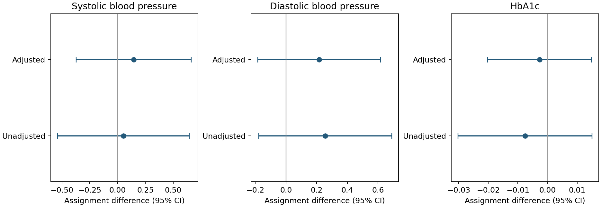

# Medicaid Lottery and Health Measures

I examined whether systolic blood pressure, diastolic blood pressure and HbA1c differed by Oregon Medicaid lottery assignment. The drawing gave selected people the opportunity to apply. I compared the groups as assigned, regardless of whether they enrolled. The teaching extract contains 12,134 records, with 5,796 selected and 6,338 unselected. [Original study](https://economics.mit.edu/research/publications/oregon-experiment-effects-medicaid-clinical-outcomes)

[Read the case study](https://666mhy666.github.io/projects/medicaid-lottery-analysis/) · Independent UCLA graduate coursework

## The check that changed the analysis

I examined outcome distributions, missingness and baseline balance. In all 12,134 records, `cvd_risk_composite` equaled the count of five pre-lottery diagnoses: diabetes, high blood pressure, high cholesterol, heart attack and congestive heart failure. I excluded the count from the follow-up outcomes and kept the three measured health outcomes.

## Findings

There was no clear difference in any of the three measures by lottery assignment. Every 95% confidence interval included zero.

| Outcome | Adjusted difference | 95% CI | Model n |
| --- | ---: | ---: | ---: |
| Systolic blood pressure | +0.145 | −0.373 to 0.663 | 12,134 |
| Diastolic blood pressure | +0.216 | −0.184 to 0.616 | 12,134 |
| HbA1c | −0.0027 | −0.0203 to 0.0149 | 12,056 |



_Unadjusted and adjusted differences with 95% household-clustered confidence intervals. The panels use different horizontal scales._

## Important limitations

Effects in either direction remain compatible with these intervals. The estimates describe assignment to the chance to apply. The unweighted teaching extract has limited sampling and transformation documentation. The full experiment used a different analysis design and estimated effects of coverage separately.

## Start here

Open [analysis.py](analysis.py) for the data checks and models. See [balance](results/balance.csv), [missingness](results/missingness.csv), [both sets of estimates](results/estimates.csv) and [model details](REPORT.md). To reproduce the output, obtain the authorized course extract described in [DATA_ACCESS.md](DATA_ACCESS.md) and run from the repository root:

```sh
python -m pip install -r requirements.txt
python analysis.py --data data/ohie.csv --output data/reproduced-results
```


The reproduction command writes a separate output copy. See [revision history](REVISION_NOTES.md) for the changes from the original coursework.

