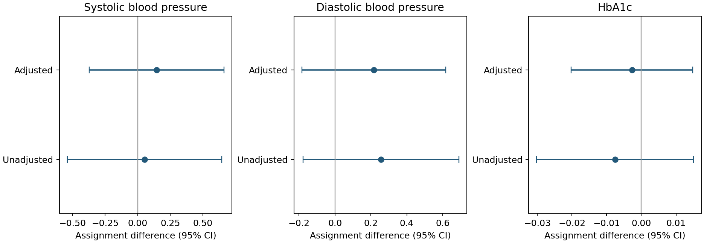

# Methods and interpretation

## Question

How did follow-up health measures differ for people selected and unselected by the Oregon Medicaid lottery? In potential-outcomes terms, the contrast is assignment to the opportunity to apply versus no assignment to that opportunity. It includes anyone in their assigned group regardless of whether they enrolled. [Original experiment](https://economics.mit.edu/research/publications/oregon-experiment-effects-medicaid-clinical-outcomes)

## Data

The extract contains 12,134 records, with 5,796 selected and 6,338 unselected. Both blood pressure measures are complete. HbA1c is missing for 38 selected and 40 unselected records, leaving 5,758 and 6,298 observations. These counts also match the samples used in the adjusted models. [Input requirements](DATA_ACCESS.md) · [Outcome availability](results/missingness.csv)

## Analysis

The coursework considered potential outcomes, group sizes, distribution plots, baseline balance, missingness, unadjusted means and adjusted regression. The revised [analysis.py](analysis.py) estimates the differences for three follow-up measures.

### Outcome definition

For every row in the supplied extract, `cvd_risk_composite` equals the sum of five binary diagnoses recorded before the lottery:

- `dia_dx_pre_lottery` for diabetes
- `hbp_dx_pre_lottery` for high blood pressure
- `chl_dx_pre_lottery` for high cholesterol
- `ami_dx_pre_lottery` for heart attack
- `chf_dx_pre_lottery` for congestive heart failure

The count was excluded from the follow-up outcome analysis. The component diagnoses enter the adjusted model as individual baseline indicators.

### Assignment models

The unadjusted regression is equivalent to selected minus unselected group means. The adjusted ordinary least squares regression adds baseline covariates, including an indicator for each observed household list-size category except the reference category. List size is the number of household members on the lottery list. The model uses an outcome-specific complete-case sample. Both regressions use household-clustered standard errors and 95% t-based intervals so the calculation can account for related measurements within the same household. The analysis uses no survey weights.

## Findings

Adjusted assignment differences were +0.145 for systolic blood pressure (95% CI −0.373 to 0.663), +0.216 for diastolic pressure (−0.184 to 0.616), and −0.0027 for HbA1c (−0.0203 to 0.0149), on the extract’s scales. All intervals include zero. The [estimates table](results/estimates.csv) preserves the unadjusted results and counts by assignment group as well. The CSV column `n_treated` counts lottery-selected records.

_Lottery-assignment differences with 95% household-clustered confidence intervals. Each outcome has its own horizontal scale._

## Assumptions and interpretation

All three intervals allow differences in either direction. HbA1c missingness is 0.66% among selected records and 0.63% among unselected records. These similar rates leave open the possibility of outcome-related missingness. The extract’s sampling and transformation documentation is incomplete. The full published study used survey weights and additional design decisions, and also estimated the effect of coverage. The teaching estimates apply to the assignment contrast in this extract.

## Result files

- [assignment-effects.png](results/assignment-effects.png)
- [balance.csv](results/balance.csv)
- [estimates.csv](results/estimates.csv)
- [missingness.csv](results/missingness.csv)
- [run.json](results/run.json)
Source context: [https://www.nber.org/research/data/oregon-health-insurance-experiment-data](https://www.nber.org/research/data/oregon-health-insurance-experiment-data)

