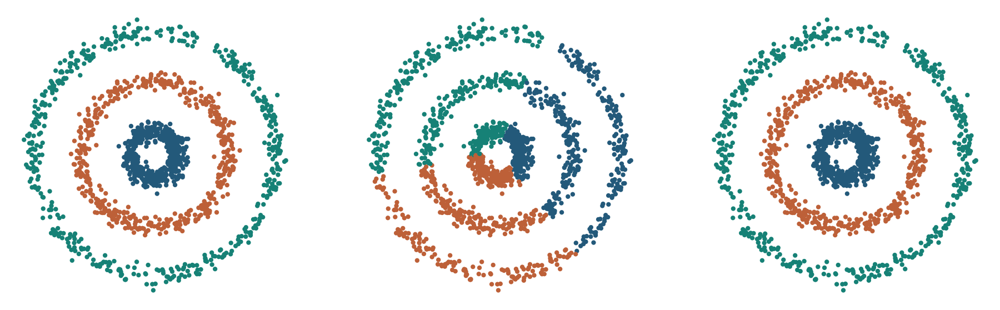

# Spectral Clustering for Nonlinear Structure

When do graph connections recover groups that straight centroid boundaries cut through? I compared ordinary k-means with nearest-neighbor and Gaussian-affinity spectral clustering on two supplied teaching examples: intertwined moons and concentric rings.

[Read the case study](https://666mhy666.github.io/projects/spectral-clustering/) · [Open the Python analysis](analysis.py) · Independent UCLA graduate coursework

## From points to a graph

I linked nearby points, normalized the affinity matrix and used its leading eigenvectors to give each point new coordinates. K-means then clustered those coordinates. The examples use the known cluster counts of two and three. The supplied labels are used after fitting to assess agreement and show the reference geometry.

## What I found

| Method | Halfmoon ARI | Bullseye ARI |
| --- | ---: | ---: |
| K-means on the original coordinates | 0.253 | 0.004 |
| Spectral with 10 neighbors | 1.0 | 1.0 |
| Spectral with Gaussian RBF affinity | 1.0 | 1.0 |

ARI measures agreement with the supplied labels. A score of 1 is a perfect match and a score near 0 indicates little agreement beyond chance. All four tested neighbor counts scored 1.0 for Halfmoon. For Bullseye, five neighbors produced five components for three rings and a saved ARI of 0.923. The score for that setting can vary with the eigensolver's choice of eigenvectors. At 10, 15 and 20 neighbors, there were three components and the scores were 1.0. [Full neighbor grid](results/clustering-comparison.csv)



[Halfmoon comparison](results/halfmoon-assignments.png) · [Original comparison including RBF](results/clustering-comparison.png)

These are descriptive results on two synthetic examples. The known group counts and chosen graph settings matter. The dense eigendecomposition limits scale.

## Reproduce

Use an authorized copy of the teaching CSVs described in [DATA_ACCESS.md](DATA_ACCESS.md). Run the analysis and graph tests from the repository root:

```sh
python -m pip install -r requirements.txt
python analysis.py --halfmoon data/halfmoon.csv --bullseye data/bullseye.csv --output data/reproduced-results
python -m unittest test_analysis.py
```

See the [report](REPORT.md) for affinity and connectivity details and the [revision notes](REVISION_NOTES.md) for what changed after the coursework.
